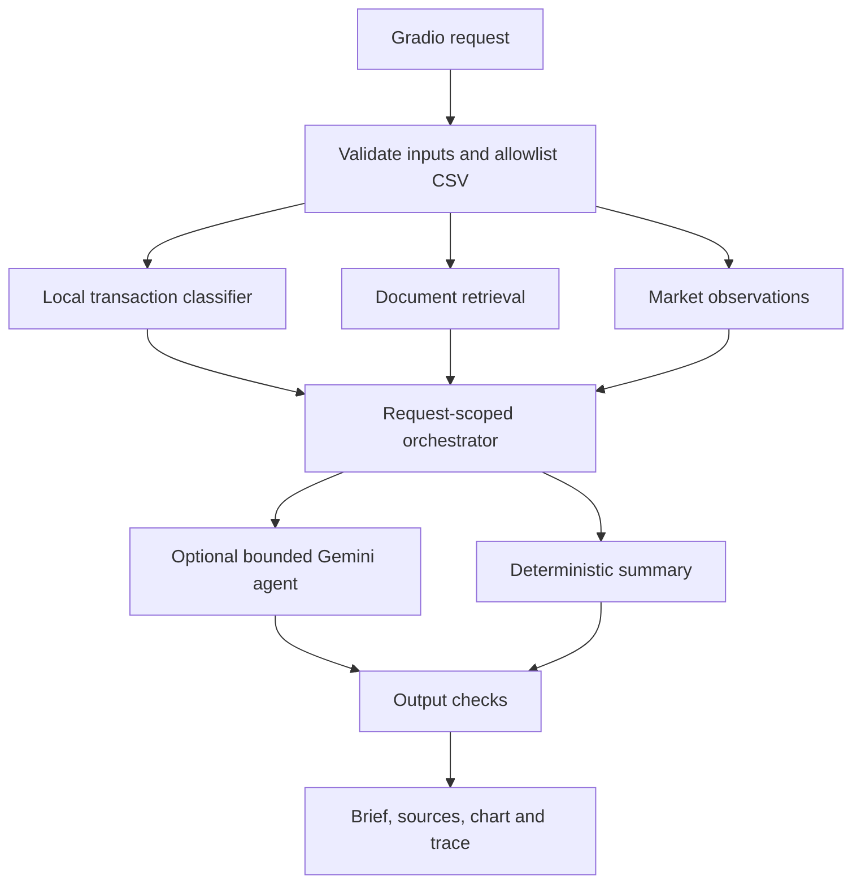

# AdvisorIQ

**Evidence before decisions.** An educational finance research workspace with document retrieval, a bounded Gemini tool-calling agent, timestamped market observations, and local transaction review.

Built by Vishal Singh Jamwal as an internship portfolio project. No brokerage access, trade execution, or real-world fraud performance claims.

## What you can demonstrate

- A working **offline demo**, without keys: synthetic prices, local document retrieval and a trained transaction classifier.
- An optional **Gemini agent** using LangChain `create_agent` with Research, MarketData and CheckTransactions tools.
- Two retrieval backends: **TF-IDF baseline** and **Gemini embeddings + persistent Chroma**.
- CSV validation, feature allowlisting, request isolation, conservative response checks, and provider-failure fallbacks.
- Research sources, transaction results, a price chart and a request-local tool trace in a Gradio workspace.
- Reproducible evaluation, tests, GitHub Actions, Docker and a Render deployment blueprint.

The default output is an extractive, deterministic summary. It does not pretend to be an AI-generated analysis. Switch on live mode and configure Gemini to use the agent.

## Quick start — Python 3.12

Extract the project and open a terminal **inside the directory containing `app.py`**.

### Windows PowerShell

```powershell
py -3.12 -m venv .venv
.\.venv\Scripts\python.exe -m pip install -r requirements.txt
.\.venv\Scripts\python.exe -m advisoriq.setup
.\.venv\Scripts\python.exe app.py
```

Using the virtual environment's Python directly avoids PowerShell activation-policy problems.

### macOS / Linux

```bash
python3.12 -m venv .venv
.venv/bin/python -m pip install -r requirements.txt
.venv/bin/python -m advisoriq.setup
.venv/bin/python app.py
```

Open **http://127.0.0.1:7860** and press **Generate research brief**. The default sample contains 10 synthetic transactions. Demo AAPL values are fictional, not Apple historical prices. Other tickers need live mode.

Direct dependencies are pinned in `requirements.txt`. `requirements.lock.txt` records the complete tested Linux/Python 3.12 environment including test dependencies. CI and Docker use that snapshot; platform-specific wheels can differ on Windows/macOS.

## Enable Gemini and market data

1. Copy `.env.example` to `.env` (`Copy-Item .env.example .env` in PowerShell; `cp .env.example .env` on macOS/Linux).
2. Add `GOOGLE_API_KEY` locally. Never commit it or put it into a screenshot.
3. Set `GEMINI_MODEL` to a model ID currently available in your Google account. See [Google's model catalog](https://ai.google.dev/gemini-api/docs/models). The model is configurable so retirements do not require code changes.
4. Restart the app and enable **Live market + optional Gemini agent**.
5. The default local retrieval backend works with the live agent. For API embeddings, run `python -m advisoriq.setup --embeddings`, then select `gemini` retrieval. Use your virtual environment's Python as in quick start.

Only numeric transaction features are processed locally. Gemini receives transaction counts, not raw records, names or account numbers. It does receive the redacted question and retrieved research text. Regex redaction is incomplete: do not type names, addresses or other sensitive personal data. An external market request sends the selected ticker to Yahoo Finance through yfinance.

LangSmith tracing is **off by default**. Set `LANGSMITH_TRACING=true` and `LANGSMITH_API_KEY` only when you accept sending redacted questions, excerpts, answers and tool outputs to LangSmith. The local Run trace tab works without it.

No live API credentials were supplied during development. The live agent loop and Chroma contracts are tested with controlled fixtures; an authenticated Gemini/embedding smoke test remains necessary on your account.

## CSV contract

| Column | Accepted values | Meaning |
|---|---|---|
| `amount` | Finite number, 0–1,000,000,000 | Amount in a consistent unit |
| `hour` | Integer 0–23 | Transaction hour |
| `is_foreign` | 0 or 1 | Supplied foreign-transaction flag |
| `merchant_risk` | Finite number 0–1 | Supplied input feature, not inferred by this app |

UTF-8 CSV, at most 2 MB and 5,000 rows. Extra columns are discarded before modeling. Duplicate headers, blanks, nonnumeric features and invalid ranges are rejected. See [`data/sample_transactions.csv`](data/sample_transactions.csv).

This is **not a raw bank-statement parser**: bank exports need mapping to this schema, and merchant risk is assumed as an input. No currency normalization is performed. The classifier is trained on synthetic values, so do not use it for real financial decisions.

## Architecture



Preflight checks create deterministic outputs even if the agent fails. Live tools can retrieve more evidence, inspect the chosen ticker and inspect transaction aggregates. Tools do not accept arbitrary filesystem paths or perform trades. Each request owns its own data and evidence list. The LangGraph recursion limit is 12; the model client has a timeout and bounded retries. This is not a hard end-to-end wall-clock budget.

## Evaluation

```bash
python -m pip install -r requirements-dev.txt
python -m pytest -q
python evaluate.py
```

See [`reports/evaluation.json`](reports/evaluation.json) for the saved run. Synthetic classifier: 3,000 training rows, 1,000 held-out rows, seed 42, decision threshold 0.5.

| Metric | Measured result |
|---|---:|
| Precision | 0.370 |
| Recall | 0.742 |
| F1 | 0.494 |
| ROC-AUC | 0.826 |
| Retrieval hit@1 | 8 / 8 |
| Retrieval hit@3 | 8 / 8 |

The classifier favors recall and produces substantial false positives (196 in this held-out set). These are honest baseline results, not production fraud accuracy. Retrieval uses eight developer-authored questions over four small notes, so its perfect hit rate is a smoke check rather than broad validation. **No RAGAS, generation faithfulness or real-world fraud score is claimed.** Changing the UI threshold changes results; these metrics describe 0.5 only.

## Research library

Bundled notes are original educational summaries, not downloaded filings or current investment research. They describe diversification, valuation, transaction review and data limitations. They cannot justify a current Apple investment recommendation.

Add curated `.md` documents under `data/docs/`, restart the app to refresh local retrieval, and rebuild embeddings after changing documents. Document chunks have stable IDs for a given corpus version; citations are only meaningful within that run/corpus. Chroma collection names include a corpus/model fingerprint. Old collections remain on disk and can be removed by deleting the generated `chroma_store/` directory when the app is stopped.

## Deploy

### Render

Connect the GitHub repository to a new Python web service or Blueprint using `render.yaml`:

- Build: `pip install -r requirements.lock.txt && python -m advisoriq.setup`
- Start: `python app.py`
- Environment: `HOST=0.0.0.0`; Render supplies `PORT`.
- Add API keys in the host's secret settings, never in Git.
- Set **both** `APP_USERNAME` and `APP_PASSWORD` before enabling a public live-key demo. Otherwise anyone with the URL can consume your quota.

Start with the local retrieval backend. To deploy Chroma embeddings, include `python -m advisoriq.setup --embeddings` in the build after configuring the key, or provision the generated index using durable storage. Local disks may be ephemeral. No free-tier memory, uptime or cost guarantee is made; check the host's current plan limits. The blueprint has not been deployed from this workspace.

### Docker

```bash
docker build -t advisoriq .
docker run --rm -p 7860:7860 advisoriq
# Optional live configuration:
docker run --rm -p 7860:7860 --env-file .env -e HOST=0.0.0.0 advisoriq
```

Docker config is supplied; a Docker build was not run during development.

## GitHub

See [`docs/GITHUB.md`](docs/GITHUB.md) for upload and Git commands. CI runs tests and uploads evaluation JSON after each push. Your `.env`, model files, vector index and virtual environment are ignored. Commit the sample data and evaluation report so reviewers can reproduce the demo.

## Learn it and present it

- [`docs/WALKTHROUGH.md`](docs/WALKTHROUGH.md): exact build/run sequence and file-by-file explanation.
- [`docs/INTERVIEW.md`](docs/INTERVIEW.md): demo script, tradeoffs, resume wording and questions to prepare.
- [`docs/SECURITY.md`](docs/SECURITY.md): data flow and explicit limitations.

## Scope and next steps

This is a complete runnable **educational MVP**, not a production wealth-management platform. It has no user database, holdings ingestion, portfolio allocation engine, trade execution, regulator certification or production monitoring. Before expanding it: add licensed/date-versioned company filings, independently labeled evaluation cases, calibrated models with real-data permissions, stronger PII controls, authentication and per-user rate limits. Citation presence checks do not prove factual entailment; prompts cannot guarantee resistance to injection.

## Implementation references

- [LangChain agents](https://docs.langchain.com/oss/python/langchain/agents)
- [Gemini chat integration](https://docs.langchain.com/oss/python/integrations/chat/google_generative_ai)
- [Chroma integration](https://docs.langchain.com/oss/python/integrations/vectorstores/chroma)
- [Gradio Blocks](https://www.gradio.app/docs/gradio/blocks)

MIT license. Bundled research notes are educational project content; linked third-party material remains with its respective owner.
